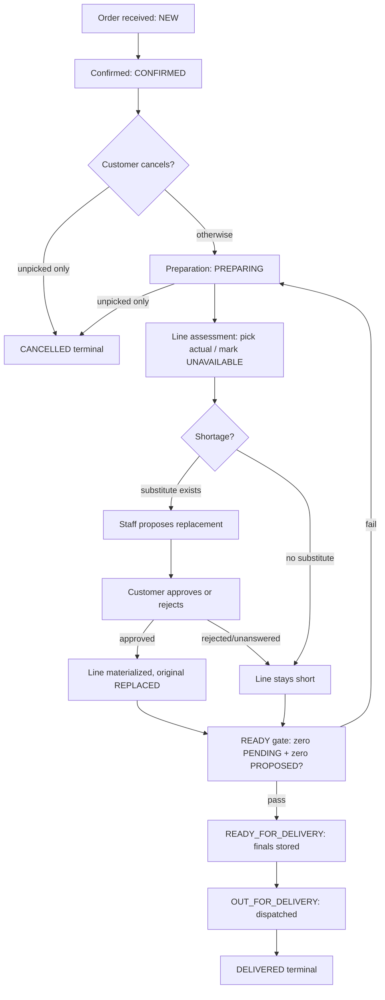

# FP-06 — Store Operations UX (Specification Only)

> Classifications: `VERIFIED` (source evidence cited) · `LOCKED` (existing applicable decision) ·
> `RECOMMENDATION` (proposed UX policy, needs owner approval only where stated) ·
> `BACKEND-CONSTRAINED` (verified gap) · `NEEDS OWNER DECISION` (genuine open business choice) ·
> `NOT VERIFIED` · `OUT OF SCOPE`. No implementation, runtime testing, backend/DB/dependency/commit/deploy
> in this phase. The interface communicates confirmed system state; it never manufactures state.

## 1. Document metadata and scope

- Phase: FP-06 Store Operations UX — specification + evidence only, pre-implementation.
- Covers: order lifecycle representation, state ownership, order-detail contents, preparation/
  availability outcomes, shortages, substitutions + decisions, actual quantities/weights, readiness
  gating, delivery progression + authoritative completion, concurrency/stale/recovery, customer
  communication, acceptance criteria, decision register. No admin UI layouts, no visual tokens.

## 2. Executive summary

The backend exposes exactly 7 order states with a frozen transition table, per-line fulfillment
outcomes (including short-shipment of unsubstituted UNAVAILABLE lines at READY), a staff-proposed /
customer-decided replacement flow with no deadline, guest access via per-order bearer credential
(90-day TTL, revoke/rotate staff-side only), and no notifications, delivery proof, ETA, tracking,
payments, or refunds. Every customer-visible claim below maps to these facts; gaps are labeled,
never papered over.

## 3. Goals and explicit non-goals

Goals: truthful lifecycle display, honest shortage/substitution/weight communication, safe
concurrency behavior, testable criteria. Non-goals: admin dashboard, visual system, notifications
infra, delivery-provider integration, payments/refunds, FP-07+ work, production readiness.

## 4. Source inventory and evidence methodology

Read directly (no endpoint-name inference): `src/lib/orders/{state-machine,fulfillment,writes,
validation,serialize,guest-access}.ts`, `src/lib/replacements/{state-machine,writes,validation}.ts`,
`src/lib/inventory/{service,serialize}.ts`, `src/lib/api/{errors,http-status}.ts`,
`src/app/api/store/orders/**` + `src/app/api/admin/orders/**` route handlers,
`docs/openapi.yaml` (98 paths), FP-04/FP-05/BG-closure governance, brand/VI-01 (unreopened).
Tests consulted for behavior shape only (not re-run — no runtime claims).

## 5. Existing locked decisions and applicable contracts

Q1 guest checkout without account (LOCKED) · single-page sequential checkout (LOCKED) · no-governorate
(LOCKED) · server price/stock/total authority (LOCKED) · PIECE vs WEIGHT + step rules (LOCKED) ·
idempotency same-key replay, no blind retry (LOCKED) · guest credential model: per-order bearer,
header-only, 90-day fixed TTL, 401 invalid/revoked, 410 expired, staff revoke/rotate + audit (LOCKED) ·
replacement R10/propose-gate/R2-gate semantics (LOCKED) · FP-03 nav order (LOCKED) · brand voice
(clear, calm, respectful Egyptian Arabic) + VI-01 direction (LOCKED) · colors unchanged (LOCKED) ·
guest credential persistence via planned HttpOnly adapter (FP03-G1; raw token never in client code).

## 5b. Operational personas & RBAC (BACKEND-CONFIRMED keys; role model per FP-11.8.5, not redefined here)

| Persona | Reads | Executes (perm) | Sensitive (confirm/reason/audit) | Hidden data | On 401/403 | Direct-access attempt |
|---|---|---|---|---|---|---|
| Preparer (orders.update holder) | Orders + lines + inventory + proposals (orders.view implied by workflow) | prepare/pick (`{actualQuantity}`)/unavailable/propose/withdraw/auto-accept/ready/dispatch/deliver (orders.update); cancel only with orders.cancel | All writes audited atomically (`auditInTx` in fulfillment + replacement txs); destructive acts get ConfirmDialog (UX-PROPOSAL per FP06-D09) | Other principals' secrets; hashes/tokens; SQL | 401 → login + resume; 403 → forbidden page (exists), no data | Blocked server-side; UI shows forbidden, never fake-empty |
| Canceller (orders.cancel holder) | Same reads | cancel unpicked only | Audited; confirm dialog (UX-PROPOSAL) | Same | Same | Same |
| Viewer (orders.view only) | Lists + details + proposals + history | Nothing mutating | N/A | Mutating affordances visible-but-disabled per FP-11.8 D45 visibility (never a security boundary) | Same | Same |
| Customer-service (customers.view) | Customer rows + addresses | Customer register/addresses ops | Audited per customer-auth design | Passwords/hashes | Same | Same |

Role mechanics (SUPER_ADMIN, 31-key matrix, ceiling/guards, last-admin 409) are FP-11.8.5 authority — reused, not
restated. Read-vs-execute split is structural: visibility never authorizes. Session loss mid-shift ⇒ login + resume;
expired/revoked permission mid-shift ⇒ forbidden on next gated call, in-progress draft preserved locally.

## 6. Actual backend order-state inventory

| Technical state | Source | Meaning | Terminal? | Produced by | Customer API exposes? | Customer may act? |
|---|---|---|---|---|---|---|
| NEW | state-machine.ts:12-13,25 | Order created, awaiting confirmation | No | createOrder tx | Yes (owner reads) | No (transient) |
| CONFIRMED | :14,26 | Confirmed; eligible for preparation or unpicked cancel | No | creation / advance | Yes | Cancel if unpicked |
| PREPARING | :15,27 | Preparation started; picking writes actuals here only | No | prepare (orders.update) | Yes | Cancel only if still unpicked |
| READY_FOR_DELIVERY | :16,28 | Gated completion: zero PENDING lines + zero PROPOSED replacements (fulfillment.ts:29-30,302+) | No | ready (orders.update) | Yes | No (read-only) |
| OUT_FOR_DELIVERY | :17,29 | Dispatched | No | dispatch (orders.update) | Yes | No (read-only) |
| DELIVERED | :18,30 | Authoritatively delivered | **Terminal** | deliver (orders.update) | Yes | No |
| CANCELLED | :19,31 | Terminated unpicked (NEW\|CONFIRMED\|PREPARING-unpicked; picked lines 409 — writes.ts:543-567) | **Terminal** | cancel (customer/staff policy) | Yes | No |

No other state exists (DB CHECKs authoritative; state-machine.ts:5-6). There is no `READY` state:
the owner's candidate `READY` maps to `READY_FOR_DELIVERY` (mapping, not a conflict).

## 7. Verified order-transition matrix

| From → To | Trigger / actor / auth | Preconditions | Success | Failures | Retry | Reversible |
|---|---|---|---|---|---|---|
| NEW→CONFIRMED | createOrder tx (customer session or guest credential) | valid cart, owned/inline address, priced lines | 201, history rows | 400/401/404/409/422/429 | same-key replay only | No |
| *→CANCELLED (NEW/CONFIRMED/PREPARING-unpicked) | customer cancel / staff cancel | zero picked lines (actuals), ownership | 200 CANCELLED, holds released, zero movements | 409 picked/further; 404 foreign | safe re-read | No |
| CONFIRMED→PREPARING | staff prepare, orders.update | CONFIRMED | 200 PREPARING | 409 otherwise | safe | No |
| PREPARING→READY_FOR_DELIVERY | staff ready, orders.update | R2 gate (no PENDING, no PROPOSED) | 200 + finals stored | 409 gate fail | safe after fixing cause | No |
| READY_FOR_DELIVERY→OUT_FOR_DELIVERY | staff dispatch, orders.update | READY state | 200 | 409 otherwise | safe | No |
| OUT_FOR_DELIVERY→DELIVERED | staff deliver, orders.update | OUT state | 200 terminal | 409 otherwise | safe | No |

## 7b. Order queue & operational workspace (BACKEND-CONFIRMED list contract; no metrics/assign/SLA)

Purpose: find work, not measure it.

1. Open order (staff; order id; orders.view; `GET admin/orders/[id]`; 200 snapshot / 404 / 401-403; none; re-read on 409-class staleness; reads unaudited per evidence; AC: detail matches §9).
2. Review lines (staff; snapshot; PREPARING or earlier; read-only; requested qty/unit per line; none; —; —; AC: PIECE vs WEIGHT visibly distinct).
3. Check availability (staff; variant; inventory read; `GET inventory/*`; available vs requested; none; unknown ⇒ retry state; —; AC: unknown never labeled OOS).
4. Pick line (staff; actual qty; PREPARING + PENDING line + orders.update; pick op `{actualQuantity}`; 200 FULFILLED/PARTIAL + SALE movement + audit / 422 envelope / 409 short|decided; commit per §13b; re-read + re-cut; audited; FP06-AC09).
5. Mark unavailable (staff; line; same gate; unavailable op; 200 UNAVAILABLE, hold kept / 409; propose-or-short path §10; re-read; audited; §10 ACs).
6. Propose substitute (staff; original + substitute variant; OOS line + orders.update; replacements propose; 200 PROPOSED / 4xx per validity; holds move on approve only; re-read; audited; FP06-AC04).
7. Staff-side decision where required (withdraw/auto-accept; orders.update; POST withdraw/auto-accept; 200 terminal-ish / 409; per §10c; re-read; audited).
8. Await customer decision (system; PROPOSED live; no op; customer decide op; approve = R10 materialization / reject = short; 409 repeat/race; re-fetch row; audited; FP06-AC05/06).
9. Reconcile price difference (system; decided proposal; totals recompute — no settlement endpoint; display recomputed totals; §10b rules; —; AC: no invented settlement).
10. Ready the order (staff; PREPARING + R2 gate + orders.update; ready op; 200 + finals / 409 cause; fix cause (decide/fulfill pending); re-read; audited; FP06-AC11/12).
11. Dispatch/deliver (staff; READY/OUT states + orders.update; dispatch/deliver ops; 200 / 409; re-read; audited; FP06-AC13/14).
12. Cancel if allowed (customer/staff with orders.cancel; zero picked lines; cancel op; 200 + holds released / 409 picked; re-read; audited).
13. Confirm saved (UI; confirmed response only; success rendering gated on 200/201 bodies; never pre-confirm; AC: no phantom success).

Partial-save state is NOT a thing: every step above is one atomic op; there is no draft-persistence endpoint for
preparation (BACKEND-GAP if a drafts UI is ever wanted — not proposed here).

Purpose: find work, not measure it. List = `GET /api/admin/orders` (orders.view): filters status/customerId/date-window
(number lookup per route comment — CONTRACT-CONFIRMED, field-level UNVERIFIED), keyset cursor pages (`limit`/`nextCursor`,
forward-only, no totals). Columns only from list rows; full truth on detail. Action-needed marking is a UX-PROPOSAL
(PREPARING + PENDING lines, or live PROPOSED = "needs decision"; no priority score exists). Loading skeletons; honest
empty; failure + retry; after any op, re-read list + detail (never trust pre-op copy); background-moved order ⇒ banner +
re-read, actions re-gated. Desktop tables; tablet scroll; mobile cards (FP-11.9 responsive, visuals later). No
assign-to-staff (no endpoint — UI must not imply assignment), no SLA/lateness counters (no timestamps beyond
created/updated), no revenue/KPI numbers (no report routes). Race safety for the shared model: `FOR UPDATE`
row locks in propose/pick txs + 409 fail-fast on moved state + atomic single-tx writes — two staff may open one
order, but only valid transitions commit; the loser re-reads before the next act (§15 rows).

## 7c. Preparation workflow (each step: actor/input/preconditions/op/perm/response/effects/failures/recovery/audit/AC)

## 8. Customer-facing status mapping

| Technical status | Arabic label | Note / action | Transient? | Classification |
|---|---|---|---|---|
| NEW | تم استلام طلبك | Informational; no action | Transient | VERIFIED |
| CONFIRMED | تم تأكيد الطلب | Cancel offered only if unpicked (server decides) | Transient | VERIFIED |
| PREPARING | جاري تجهيز طلبك | Replacement decisions may appear here; cancel only if still unpicked | Transient | VERIFIED |
| READY_FOR_DELIVERY | طلبك جاهز | Read-only; means preparation accepted, not yet moving | Transient | VERIFIED |
| OUT_FOR_DELIVERY | طلبك خرج للتوصيل | Read-only; no ETA/map (no source) | Transient | VERIFIED |
| DELIVERED | تم تسليم الطلب | Terminal; final totals shown | Terminal | VERIFIED |
| CANCELLED | تم إلغاء الطلب | Terminal; no further actions | Terminal | VERIFIED |

Unknown-but-known future states: neutral fallback (“جارٍ تحديث حالة الطلب — حاول لاحقًا”), never raw
codes — RECOMMENDATION (display policy; no backend change).

### 8b. Customer status-message matrix (labels LOCKED §8; copy approved FP-04/FP-05 or COPY-PROPOSAL marked)

| Internal state | Customer label (§8) | AR message + source | Shortage/replacement effect | Update timing | Refresh source | Not inferable |
|---|---|---|---|---|---|---|
| NEW | تم استلام طلبك | FP-04 copy (approved) | — | On creation read | Order read | Queue position, timing |
| CONFIRMED | تم تأكيد الطلب | FP-04 copy | Cancel iff unpicked | On read | Order read | Prep start time |
| PREPARING | جاري تجهيز طلبك | FP-04 copy | PROPOSED rows surface here | On read/refresh | Order + replacement reads | Per-line progress % |
| READY_FOR_DELIVERY | طلبك جاهز | FP-04 copy | Short lines shown short | After confirmed READY read | Order read (finals) | Dispatch time |
| OUT_FOR_DELIVERY | طلبك خرج للتوصيل | FP-04 copy | — | After confirmed dispatch | Order read | ETA/location/courier |
| DELIVERED | تم تسليم الطلب | FP-04 copy + final total | Final totals | After confirmed deliver | Order read | Proof/recipient |
| CANCELLED | تم إلغاء الطلب | FP-04 copy | Terminal | After confirmed cancel | Order read | Reason beyond policy message |
| Short line | Short display (§10) | FP-04/FP-05 shortage copy | Reduced total | At READY read | Order lines | Refund/credit (none exists) |
| PROPOSED live | Action-required | «يوجد بديل مقترح بانتظار قرارك…» (approved FP-04) | Blocks READY until resolved | On read | Replacement reads | Deadline (none exists) |
| Actuals available | Requested vs actual | Three-way display (rule, §11) | Final totals | After pick reads | Order lines | Settlement (none exists) |

No GPS/ETA/SMS/WhatsApp/push/delta-settlement claims — all VERIFIED absent (§21 C3/C5/C6).

## 9. Order detail and information consistency requirements

Authoritative per line: product/variant names, requested vs actual quantities + units, unit price,
line totals (`final_total` from pick time; NULL until picked), item status, replacement links.
Order level: HM number (SQL-composed, never client-built), snapshots (customer/address frozen at
creation), subtotal/discount/delivery/total + finals (`subtotalFinal/totalFinal` stored at READY;
`discount_total` never rewritten), timestamps. Frontend never recalculates totals. Requested vs
actual must be visually distinct; NULL actual = “not yet weighed/picked”, never zero.

## 10. Product preparation and stock shortages

Verified outcomes per PENDING line in PREPARING orders: picked within R7 envelope → FULFILLED (or
PARTIALLY_FULFILLED); envelope breach → 422 nothing written; stock-short at commit → 409 (re-cut or
mark unavailable); mark unavailable → UNAVAILABLE, hold kept until READY release; repeat pick on
decided line → 409. Reactions: surface server outcome verbatim; never auto-cap quantities.

### Shortage policy (VERIFIED — fulfillment.ts:29-32,335-357)

Unsubstituted UNAVAILABLE lines ship short (final 0) and the order still reaches READY; blocking
READY would strand uncancelable (picked) orders. Customer UI shows short lines as short (missing
from fulfilment, total reduced), never as cancelled-by-customer and never as fulfilled. No automatic
refund/credit/reschedule exists — invent none; money truth is the stored finals.

### Shortage-states matrix (BACKEND-CONFIRMED — never merged)

| Shortage | Detected by | Staff may | Order data kept | Partial op? | Revalidate? | Order-total effect | Customer sees | Staff sees | Decision needed? | Errors/recovery |
|---|---|---|---|---|---|---|---|---|---|---|---|
| Fully OOS | Pick attempt / inventory read | Mark unavailable; propose substitute | Original line + UNAVAILABLE flag | Via replacement only | Yes | Reduced at READY | Short line | UNAVAILABLE + propose CTA | Propose-or-short | unavailable op; 409 races → re-read |
| Partial (less than asked) | Pick weighs less | Pick actual (envelope) | Requested + actual | Yes (actual) | Yes | Recomputed | Requested vs actual | Both qtys | No | 422 breach → re-cut |
| Variant-specific OOS | Per-variant availability | Same, per line | Per-line flags | Per line | Yes | Per line | Per-line status | Per-line status | Per line | Same |
| Inactive product | Liveness gating (add/pick reject) | Nothing sellable; propose swap iff valid substitute | Line flagged | No | Yes | Excluded | Not buyable | Inactive flag | Propose-or-short | Reject → message |
| Stock moved post-creation | Commit-time R3 check | Re-cut or mark unavailable | Original request | Actual only | Yes | Recomputed | Updated truth | Conflict banner | Re-cut choice | 409 → re-read |
| Invalid requested qty | Step/envelope validation | Fix to valid qty | Nothing until valid | No | Yes | None yet | Field error | Constraints | Fix qty | 400/422 → fix |
| Gone-mid-prep (deleted/deactivated) | Pick reject | Mark unavailable path | Flag | Via replacement | Yes | Reduced | Short/status | Flag | Propose-or-short | Reject → message |

No line is deletable post-creation and no requested qty is editable post-creation — only pick-actuals,
unavailable-marking, and the replacement lifecycle change lines, each via its own op.

## 11. Weighted products and actual quantity

Requested quantity (exact decimal string, step-validated at cart/checkout) vs `actualQuantity`
(authoritative only after a pick write in PREPARING). Envelope: actual must satisfy
`envelopeAllows(requested, actual, type/step/unit)` or 422. Money: `final_total =
ROUND(actual × unit_price)` recomputed and DB-reverified. Display: requested, actual (when known),
unit always labeled (kg vs g never bare), estimate flagged non-final until picked. No tolerance/
rounding/approval inventions. If a needed distinction is absent, mark BACKEND-CONSTRAINED (none
found beyond the above — the contract is sufficient).

## 11b. Canonical scenario: requested 1.25 kg Romi vs actual 1.18 kg (difference −0.07 kg)

The pick op writes the weighed fact; money follows (`final_total = ROUND(actual × unit_price)`, DB-reverified);
difference is DERIVED for display (never a stored field, never a settlement instruction — no settlement endpoint exists).

| Outcome | Staff can | Saving op? | Backend allows? | Reprice/settle? | Customer approval needed? | Customer accept/reject via API? | Inventory | Order summary shows | Final price supported? |
|---|---|---|---|---|---|---|---|---|---|
| Equal (1.25 = 1.25) | Pick 1.25 | pick `{actualQuantity: 1.25}` | Yes (envelope) | Totals recompute | No | N/A | Commit actual, SALE movement | Requested = actual, final | Yes (stored) |
| Short (1.18 < 1.25) | Pick 1.18 | Same op | Yes (envelope) | Totals recompute down | No (no approval endpoint for qty deltas) | No qty-approval op exists | Commit 1.18 | Requested 1.25 vs actual 1.18 vs final | Yes (stored) |
| Over (actual > requested) | Pick actual | Same op | Iff envelope allows, else 422 | Totals recompute up | No | No | Commit actual | Same three-way display | Yes (stored) |
| Partial availability | Pick what's there | Same op | Yes | Recompute | No | No | Commit picked | Actual + short note | Yes |
| Fully OOS | Mark unavailable → propose-or-short | unavailable op | Yes | Short path §10 | Only via replacement decide | Only replacement decide | Hold to READY release | Short line, reduced total | Yes (final 0) |
| Actual unknown yet | Nothing (no draft-save op) | None exists | N/A | No | No | No | Untouched | Requested + "not yet weighed" | Not yet (NULL) |
| Save failed (422/409/5xx) | Re-cut / re-read / retry-once-safe | Same op | Per cause | No invented totals | No | No | Untouched (nothing written) | Pre-op truth + error | Unchanged |
| Order moved mid-prep | Re-read, re-gate actions | Per new state | Per new state | No | No | No | Per confirmed ops only | Authoritative state | Per state |
| Invalid actual (step/envelope breach) | Fix quantity | Same op | No (422) | No | No | No | Untouched | Error + constraints | Unchanged |

No financial settlement, refund, credit, or delta-payment mechanic exists — the recomputed final total IS the
settlement. Stating otherwise would invent a capability. Totals rule (G3 decision): amount due is always the
current backend-confirmed total — `totalEstimated` before preparation, `totalFinal` once READY stores it
(schema.prisma:299-304); the derived −0.07 kg / price difference is display-only, never a ledger entry; tender
mechanics are out of scope (Q-PAY open — no payment-method policy asserted here).

## 12. Substitution lifecycle and customer decision states

Entities: proposal rows (PROPOSED → CUSTOMER_APPROVED/CUSTOMER_REJECTED/AUTO_ACCEPTED;
state-machine.ts; no expiry/deadline mechanism anywhere — VERIFIED absent). Propose is staff-side
(OOS flip or swap-freeze per R2); approve requires CUSTOMER decider (guest approvals record
CUSTOMER_APPROVED with GUEST/NULL decider — writes.ts:249-254,402-408); reject flips with no
inventory effect; decided-then-replayed and approve-vs-reject races land 409 via the PROPOSED gate;
approval reserves substitute + releases original + materializes the line in one tx.
Comparison shows only API-present fields (original/substitute names, images if present, variant/unit,
requested vs proposed quantities, authoritative unit prices, computable difference, live status,
currently-allowed action). Stored `priceDifference` per row (`schema.prisma:385`) is the displayed delta —
recomputed display math must match it, never replace it. No countdown/timer claims. Sequential re-proposals
are BACKEND-CONFIRMED on still-UNAVAILABLE lines (each a new independent PROPOSED row; decided rows stay
terminal and preserved — `writes.ts:163-164,201-209`): withdraw-or-decide-first, then propose anew; an open
proposal blocks the next (409 partial-UQ, `writes.ts:227-229`); picked lines (actual set) and
non-PENDING/UNAVAILABLE lines refuse (409, `writes.ts:182-188`). Re-propose CTA renders only when the line is
UNAVAILABLE with no live PROPOSED; per-proposal history lists every row.
Decision UX states: loading · action-required · submitting · confirmed-accepted · confirmed-rejected ·
already-recorded (409) · ineligible (state moved) · conflicted (409 race) · uncertain-network
(re-fetch authoritative row; no blind resubmit). Rejection leaves the line short (see §10), never
auto-removes the order.

### 12b. Replacement matrix (BACKEND-CONFIRMED states; PROPOSED → 3 terminal, no expiry)

| State / event | Actor | Operation | Permission | Customer action | Inventory / price impact | Recovery |
|---|---|---|---|---|---|---|
| PROPOSED created | Staff | replacements propose | orders.update | None yet | None (holds move only on approve) | Re-read line |
| CUSTOMER_APPROVED (session) | Customer | decide approve | Owner session | Approve | Reserve substitute + release original + materialize, one tx | Re-fetch row |
| CUSTOMER_APPROVED (guest) | Guest holder | decide approve + `x-guest-order-token` | Order credential | Approve | Same (decider GUEST/NULL) | Same |
| CUSTOMER_REJECTED | Customer/guest | decide reject | Owner/credential | Reject | None (line stays short) | Same |
| AUTO_ACCEPTED | Staff | auto-accept (customer-consented coverage) | orders.update | Pre-consented | Same as approve | Same |
| Withdrawn (staff) | Staff | withdraw | orders.update | Sees removal | None | Re-read |
| Decided → replay/race | Anyone | decide again | Same as decide | Blocked | None | 409 + re-fetch (never resubmit blind) |
| Substitute gone stale | System | Validity at decide time | — | Ineligible shown | None | Re-propose path: SUPPORTED on still-UNAVAILABLE lines (new row; §12 rule above) |
| Re-proposed after decision | Staff | replacements propose (new row) | orders.update | New PROPOSED row; old decided rows preserved | None until decided | Withdraw-or-decide-first; 409 if a proposal is already open |
| Invalid substitute | Staff attempt | propose validation | orders.update | None | None | 4xx + fix |

Price differences (BACKEND-CONFIRMED recompute; NO settlement policy exists — none invented): expensive /
cheaper / same-price / weighted substitute — all handled by line materialization at the substitute's
authoritative unit price with recomputed order totals shown to both sides; substitute gone stale before decide ⇒
ineligible; price moved pre-decide ⇒ decide evaluates live data (re-fetch); apply failure post-approve ⇒ tx atomic
(no half-applied state), re-read truth.

### 10c. Staff/admin vs customer approval matrix

| Decision | Owner | Internal or customer-gated? | Condition | API | Permission | Separate customer approval in system? | On reject | On no-response | Order/stock/price effect | Message basis |
|---|---|---|---|---|---|---|---|---|---|---|
| Pick actual / mark OOS | Staff | Internal | PREPARING + PENDING line | pick / unavailable | orders.update | No | N/A | N/A | Commit / hold-kept | Server outcome |
| Propose substitute | Staff | Internal | OOS line | replacements propose | orders.update | No | N/A | Proposal stays live (no deadline) | None yet | Server outcome |
| Withdraw proposal | Staff | Internal | PROPOSED | withdraw | orders.update | No | N/A | N/A | None | Server outcome |
| Auto-accept | Staff | Internal (pre-consented coverage) | PROPOSED + coverage | auto-accept | orders.update | Standing consent, not per-proposal click | N/A | N/A | As approve | Server outcome |
| Approve substitute | Customer | Customer-gated | PROPOSED + workable order | decide approve | Owner session / order credential | The decide op IS the approval | — | Stays PROPOSED (blocks READY until resolved/withdrawn) | R10 materialization | Server outcome |
| Reject substitute | Customer | Customer-gated | PROPOSED | decide reject | Owner / credential | Same op | Line short, no inventory effect | Same as reject path | None | Server outcome |
| Ready/dispatch/deliver/cancel | Staff (+customer cancel) | Internal (cancel: either) | Gates per §7 | ready/dispatch/deliver/cancel | orders.update (cancel: +orders.cancel) | No | N/A | N/A | Finals / release / terminal | Server outcome |

Contract-fixed vs UX-proposed vs open: everything above is contract-fixed except ConfirmDialog placement (UX-PROPOSAL,
FP06-D09) — no open business rule remains in this matrix.

## 13. Readiness and READY preconditions

Preconditions (all VERIFIED): order in PREPARING; zero PENDING lines; zero live PROPOSED
replacements; performed via staff ready op (orders.update); finals computed atomically
(`subFinal − min(discount, subFinal) + deliveryFee`); repeat safe; failures are 409 with cause.
Customer result: “طلبك جاهز” only after the confirmed state is read back. “All rows reviewed” ≠
READY. Short orders reach READY with finals reflecting fulfilled + zeroed-short lines.

### 13b. Inventory impact matrix (BACKEND-CONFIRMED timing; Reserved vs Available vs On-hand per GENERATED model)

| Operation | Prior | Effect (verified) | Timing | Atomic? | Reverse/compensate? | Staff sees | On failure | On repeat | Audit / movement |
|---|---|---|---|---|---|---|---|---|---|
| Create order | Available stock | Conditional reserve (available ≥ qty, rowcount-checked; loser 409) | Checkout tx | Yes | Release on cancel | Reserved lines | 409 → re-cut | Same-key replay (no double reserve) | Holds (no movement yet) |
| Pick line | Reserved hold | Commit: quantity −= actual, reserved −= requested (full hold released both R7 cases); SALE movement | Pick tx | Yes (write + movement + audit) | None (terminal write) | Actual + final_total | 422/409: nothing written | 409 decided | SALE movement + audit |
| Mark unavailable | Reserved hold | Hold KEPT (not released) | Unavailable tx | Yes | Released at READY | UNAVAILABLE flag | 409 → re-read | Safe re-read | Audit |
| Propose substitute | Holds as-is | None (holds move only on approve) | Propose tx | Yes | Withdraw | PROPOSED row | 4xx → fix | Safe | Audit |
| Approve substitute | Holds | Reserve substitute + release original + materialize | Decide tx | Yes (one tx) | None | Materialized line | 409 → re-fetch | Never resubmit | Audit |
| Reject substitute | Holds | None (line stays short) | Decide tx | Yes | None | Short line | 409 → re-fetch | Never resubmit | Audit |
| Auto-accept / withdraw | Holds | As approve / none | Staff tx | Yes | None | Updated row | 409 → re-read | Safe re-read | Audit |
| Ready | Committed + held | Finals stored; UNAVAILABLE holds released | Ready tx | Yes | None | READY + finals | 409 cause → fix | Safe after fix | Audit |
| Cancel (unpicked) | Holds | Holds released, zero movements | Cancel tx | Yes | N/A (terminal) | CANCELLED | 409 picked → re-read | Safe re-read | Audit |
| Dispatch/deliver | Finals | None (status only) | Advance tx | Yes | None | New state | 409 → re-read | Safe | Audit |
| Manual adjust (inventory ops) | Stock | adjust/reserve/release/commit per inventory service (`inventory/service.ts`) | Admin inventory tx | Per op | Per op | Updated availability | Per op | Per op | Movements + audit |

No shrink/waste/adjustment inventions: only the ops above move stock; anything else the UI needs but cannot
read is a gap, never a computed value.

## 14. Delivery and authoritative completion

READY_FOR_DELIVERY (prepared, stationary) vs OUT_FOR_DELIVERY (dispatched) vs DELIVERED (terminal)
are distinct because the backend provides them; labels must not blur the three. Each advance is a
staff `orders.update` op on the exact expected state; completion counts only when the backend
records DELIVERED. No customer confirm-delivered endpoint exists (VERIFIED absent) — do not spec one.
No timestamps beyond created/updated, no proof, no recipient, no courier identity, no ETA, no GPS:
all BACKEND-CONSTRAINED/absent — the UI shows state + final totals only. The row `updatedAt` is the sole
trustworthy time signal (shown as "last update" where useful, never as ETA). Stale/failed delivery
updates: re-read authoritative state; never display a transition the server did not confirm.

### 14b. Barcode UX & operational lookup (BACKEND-CONFIRMED lookup; no device integration)

`GET /api/store/catalog/codes/lookup?code=` (public): resolves to exactly one variant + product (active rows
only); returns price basis + size info; weighed totals NOT computed here; invalid ⇒ 400 "Invalid code.";
unknown ⇒ 404 "Product code not found." Admin codes CRUD exists under products.create (metadata), separate
capability. UX: scanner-as-keyboard input accepted (plain text field, no SDK); result shows variant + product +
price basis + stock link (separate inventory read); unknown ⇒ 404 guidance + manual search path; inactive ⇒
unresolvable (404, never shown as buyable); OOS ⇒ resolved row + «غير متوفر» via inventory (lookup alone never
claims availability); wrong-variant-vs-order ⇒ warning, no auto-swap; duplicate scan ⇒ idempotent display (lookup
is a read; acting still needs the op); slow/failed lookup ⇒ retry state, never a guessed mapping; scanned result
never triggers a sensitive op by itself (explicit staff action + perm + op still required). No scale/electronic-
weighing integration, no Barcode SDK, no CSV/Excel import (all VERIFIED absent — BACKEND-GAP if ever wanted).
Acceptance: match renders variant+price basis; unknown/inactive/OOS/duplicate/failure paths per above; no op
executes from scan alone; permission-gated acts still gate.

### 14c. Operational quick actions (each bound to state + perm + op; unsupported items listed, not rendered)

| Action | Visible to | Permission | Shows when | Preconditions | Executes | Confirm? | Loading | Success | Failures | Repeat risk | Effects | Audit? | Acceptance |
|---|---|---|---|---|---|---|---|---|---|---|---|---|---|
| Open order | Staff | orders.view | Queue/detail | — | GET detail | No | Skeleton | Snapshot | 404/401-403 | Safe | None | Reads unaudited | §9 fields render |
| Review items | Staff | orders.view | Detail | — | Reads | No | Skeleton | Lines + req/actual | Stale → banner | Safe | None | — | PIECE/WEIGHT distinct |
| Start preparation | Preparer | orders.update | CONFIRMED | CONFIRMED | prepare | No | Pending | PREPARING | 409 → re-read | Safe | Status + history | Yes | State advances |
| Show unavailable | Staff | orders.view | Detail | — | Reads | No | — | Flagged lines | — | Safe | None | — | §10 display |
| Barcode scan | Staff | Public lookup + orders.view | Detail/prep | — | codes lookup | No | Pending | Resolved row | 400/404 → guidance | Safe (read) | None | — | §14b paths |
| Record pick result | Preparer | orders.update | PREPARING + PENDING line | Envelope-valid actual | pick | No | Pending | FULFILLED + movement | 422/409 → fix | 409-guarded | §13b row | Yes | FP06-AC09 |
| Propose substitute | Preparer | orders.update | OOS line | Valid substitute | propose | Optional | Pending | PROPOSED | 4xx → fix | Safe | None yet | Yes | FP06-AC04 |
| Re-propose substitute | Preparer | orders.update | UNAVAILABLE line + no live PROPOSED | New valid substitute | propose (new row) | Optional | Pending | New PROPOSED; history kept | 409 open/picked → withdraw-or-decide-first | New row only | None yet | Yes | FP06-AC25 |
| Staff decide (withdraw/auto) | Preparer | orders.update | PROPOSED | Coverage/validity | withdraw/auto-accept | Per D09 | Pending | Terminal-ish | 409 → re-fetch | Never blind | Per §10c | Yes | Decided state |
| Follow customer decision | Staff | orders.view | PROPOSED live | — | Re-reads | No | — | Approved/rejected shown | Stale → re-read | Safe | Per §10c | — | No pre-claim |
| Complete preparation | Preparer | orders.update | R2 gate met | §13 | ready | Optional | Pending | READY + finals | 409 cause → fix | Safe after fix | Finals | Yes | FP06-AC11/12 |
| Advance delivery | Preparer | orders.update | READY / OUT states | Exact state | dispatch/deliver | No | Pending | New state | 409 → re-read | Safe | Status | Yes | FP06-AC13/14 |
| Cancel order | Canceller | orders.cancel | Unpicked only | Zero picked | cancel | Yes (UX-P) | Pending | CANCELLED + release | 409 picked | Safe re-read | Release | Yes | Terminal |
| Reload after conflict | Staff | Current perms | Any conflict | — | Re-read | No | Pending | Truth | — | Safe | None | — | No phantom |
| Open history/audit | Staff | orders.view (+audit_logs.view for log screen) | Detail | — | Reads | No | Skeleton | Rows | 403 → forbidden | Safe | None | — | No leak |

Never rendered (no endpoints): assign-to-staff, SLA timers, revenue/KPIs, ETA/maps, push-outreach, refund/credit,
customer-confirm-delivered, draft-save. Hidden-by-perm ≠ authorized: every tap re-gates server-side.

## 15. Concurrency, errors, stale data, and recovery

| Action | Endpoint/op | Success | Failures (verified) | May-have-succeeded? | Recovery | Refresh? | Retry | Message |
|---|---|---|---|---|---|---|---|---|
| Read order | GET orders/[id] | 200 snapshot | 401 no/invalid/revoked token; 410 expired; 404 foreign/unknown; 429 bucket | No | login / support-rotate / backoff | n/a | safe (read-only) | mapped Arabic |
| Cancel own | POST cancel | 200 CANCELLED | 409 picked/further; 404 foreign; 401/410 guest | No (tx atomic) | re-read state | yes | safe re-read only | policy message |
| Decide replacement | POST decide | 200 decided | 409 decided/race/state-moved; 404 foreign; 401/410 guest | No (gated tx) | re-fetch proposal row | yes | no blind resubmit | outcome message |
| Staff advance/pick/ready/dispatch/deliver | admin ops | 200 new state | 409 illegal/repeat; 422 envelope; 404 unknown | No (guarded txs) | re-read order | yes | safe after cause fixed | staff Arabic (admin UI phase) |
| Rate-limited guest read | any guest read | 200 | 429 bucket | No | backoff + manual retry | yes | yes, backed off | “too many tries” message |
| Two staff, one order | any admin op | 200 winner | 409 loser (state moved) | No (loser untouched) | re-read, re-gate | yes | safe after re-read | conflict banner, no blame |
| Double pick-save | pick | 200 once | 409 decided/envelope | No (single write) | re-read line | yes | never blind resubmit | decided/envelope message |
| Staff session expiry mid-prep | any gated op | 200 | 401 | No | login + resume, draft kept locally | yes | safe after login | resume prompt |

Rules: single-flight reads (no overlapping refresh loops); stale responses never overwrite newer
renders (sequence/`updatedAt` guard); mutating retries only where idempotent (same-key order replay;
decide is NOT idempotent — re-fetch first); never optimistic acceptance/rejection/readiness/delivery/
price outcomes; preserve form context across recoverable failures.

## 16. Customer communication and notification boundaries

Supported mechanisms: none for push (no inbox, SSE, WebSocket, SMS, email, or staff-outreach
contract — VERIFIED absent; backend-admin.md: notifications deferred). Therefore: state is fetched
(read on open/return, manual refresh, narrow conditional polling per FP-04 refresh contract —
RECOMMENDATION already closed there, not re-decided here). Every outcome gets: status label +
(only where contract-backed) explanation/inline item note/action/conflict message. Secrets, hashes,
tokens, UUIDs-as-proof, stack traces, and SQL never surface. Arabic follows FP-04/FP-05 locked copy
(unchanged here).

### 16b. Permissions & audit matrix (BACKEND-CONFIRMED keys; reads unaudited per evidence)

| Operation | Permission (real) | Read / write | Sensitive + extra confirm | UI when denied | Direct-call behavior | Error shown | Audited? (actor/entity/change) |
|---|---|---|---|---|---|---|---|
| List/read orders + lines + history | orders.view | Read | No | Forbidden page; affordances disabled (not a boundary) | 401/403, no data | Generic, no internals | No row claimed (reads) |
| prepare/pick/unavailable/propose/withdraw/auto-accept/ready/dispatch/deliver | orders.update | Write | Destructive ones confirm (UX-PROPOSAL) | Same | Same | Same | Yes — atomic `auditInTx` in tx |
| Cancel (either side) | Customer: ownership; staff: orders.cancel | Write | Yes + confirm | Same | Same | Same | Yes |
| Decide approve/reject | Owner session / order credential | Write | Yes + confirm | Gated state, no data | 401/410/404 per §15 | Outcome message | Yes (decider recorded incl. GUEST/NULL) |
| Customer rows/addresses ops | customers.view | Both | Per customer-auth design | Same | Same | Same | Per design (auth writes audited where supported) |
| Users/roles/grants | users.*/roles.* (+ceiling/guards) | Both | Yes | Same | Same | Same | Yes (admin identity ops) |
| Settings view/edit | settings.view / settings.manage | Read / write | Edit audited | Same | Same | Same | Edit yes |
| Audit reads | audit_logs.view | Read | No | Same | Same | Same | The log IS the record (append-only) |
| Codes lookup (ops use) | Public | Read | No | N/A | 400/404 guidance | Guidance only | No |

No permission invented; no redistribution proposed. Anything the UI needs but no key grants is a
PERMISSION-GAP (none found in the §14c action set — every listed action has its key above).

## 17. Customer/guest access and authorization

Registered: session ownership per order (`getCustomerOrder`); foreign → 404. Guest: per-order
bearer in `x-guest-order-token` header only (never URL/storage-logs/new mechanisms); 90-day fixed
TTL; 401 invalid/revoked, 410 expired; staff revoke/rotate + audit; order number/phone alone never
authorize; guests never forced to register to view/decide own orders; refresh/new-tab/return flows
work while the credential lives; lost credential ⇒ support path only. Session expiry ⇒ login +
resume; no privilege weakening for UI convenience.

## 18. Conceptual workflow diagram



Legend: rectangles = backend states (technical names); diamonds = routing conditions, not states.
Actors: customer (cancel/decide/track), staff (prepare/pick/propose/ready/dispatch/deliver, RBAC),
system (atomic transitions/audit). Source of truth per step: backend row + history; customer sees
§8 labels; blockers/recovery per §§10–15.

## 19. Decision register

| ID | Topic | Statement | Classification | Evidence / authority | Customer impact | Operational impact | Options | Recommended | Owner approval? | Dependencies | Status |
|---|---|---|---|---|---|---|---|---|---|---|---|
| FP06-D01 | Status wording | Use §8 Arabic labels | LOCKED + VERIFIED | Brand voice; state-machine.ts | clarity | none | — | — | No | — | CLOSED |
| FP06-D02 | History display | Show current status (+ timeline iff history exposed) | VERIFIED (history rows exposed in reads) + RECOMMENDATION (presentation choice, advisory) | order reads incl. history rows | transparency | none | current-only vs timeline | Either presentation satisfies the contract; no owner rule mandates timeline | No | order read shape | DOCUMENTED — ADVISORY (non-binding; not owner-approved) |
| FP06-D03 | Shortage summary | Show short lines as short, totals reduced | LOCKED + VERIFIED | L1 rule; fulfillment short-ship | honesty | none | — | — | No | §10 | CLOSED |
| FP06-D04 | Weight difference display | Requested vs actual + unit + estimate-vs-final | VERIFIED | R7/actual/final_total mechanics | trust | none | — | — | No | §11 | CLOSED |
| FP06-D05 | Replacement comparison | Show only API-present fields | VERIFIED | replacement serializers | informed choice | none | — | — | No | §12 | CLOSED |
| FP06-D06 | Decision availability | Decide only while PROPOSED + order workable | VERIFIED | PROPOSED gate, 409s | no dead buttons | none | — | — | No | §12/15 | CLOSED |
| FP06-D07 | Refresh policy | Fetch on open/return/action; narrow conditional polling | RECOMMENDATION (cadence detail, advisory) — core behavior already governed by FP-04's locked refresh contract (60s conditional + backoff; guest reads 60/15min bucket) | No push infra (verified absent); FP-04 refresh contract; rate-limit.ts | freshness vs noise | read-bucket load | manual-only vs conditional poll | Conditional poll per §15–16; cadence is frontend policy, not a backend guarantee | No | rate limits | DOCUMENTED — ADVISORY (non-binding; not owner-approved) |
| FP06-D08 | Conflict presentation | Re-read truth, explain outcome, no silent replay | VERIFIED (rule) — message copy itself follows §16/brand voice as an advisory detail, not a separate approved rule | 409 gates; atomic txs | no phantom states | none | — | — | No | §15 | CLOSED |
| FP06-D09 | Confirmation dialogs | Optional confirms for cancel/decide destructive acts | RECOMMENDATION (advisory — no locked rule mandates dialogs; server guards execute regardless) | No destructive-confirmation rule found in locked docs; server-side policy gates act independently | fewer accidents | none | confirm vs direct | Confirm on cancel + reject; direct on approve (advisory; visuals later) | No | — | DOCUMENTED — ADVISORY (non-binding; not owner-approved) |
| FP06-D10 | Unfulfilled display | Show as short, actionless | VERIFIED | finals/READY mechanics | clarity | none | — | — | No | §10/13 | CLOSED |
| FP06-D11 | Deadline/expiry | No countdown/deadline shown | VERIFIED (absent) | No expiry mechanism anywhere | no false urgency | none | — | — | No | §12 | CLOSED |
| FP06-D12 | Guest continuity | Token-gated return access; support-only recovery | LOCKED + VERIFIED | BGGO model; guest-access.ts | access without account | support load | — | — | No | §17 | CLOSED |
| FP06-D13 | Unknown-state fallback | Neutral non-code message | RECOMMENDATION (advisory — defensive policy for a class with zero observed instances; closed status set is frozen so no unmapped state is expected) | No unmapped state observed | robustness | none | — | Fallback text + retry (advisory copy; visuals later) | No | §8 | DOCUMENTED — ADVISORY (non-binding; not owner-approved) |
| FP06-D14 | Re-proposal after decision | Offered as new row on still-UNAVAILABLE lines; blocked while a proposal is open or the line is picked/decided-terminal | BACKEND-CONFIRMED (`writes.ts:163-164,186-188,227-229`; rows preserved, never rewritten) | full per-proposal history | none | offer-new-row vs hide | New-row sequence with history; hide CTA unless UNAVAILABLE + no live PROPOSED | No | replacement writes | CLOSED — EVIDENCE-BACKED |

*Advisory UX refinements need no owner sign-off; visual execution belongs to later phases.

### 19b. Screen & component mapping (behavior only; names per FP-11.8 / FP-12 / FP-03 A-* screens)

| Concept (this spec) | FP-11.8 / FP-12 / FP-03 anchor | Data + API + perm | States | Interactions | Responsive/a11y | Success bar | Cannot do (limits) |
|---|---|---|---|---|---|---|---|---|
| Orders table/list | FP-11.8 orders + FP-12 DataTable + A-ORDERS | List rows; `GET admin/orders`; orders.view | Load/empty/fail | Filter/page/open | Scroll/cards; RTL tables | Work found | Metrics/assign/SLA |
| Order details | FP-11.8 detail + A-ORDER | Full order; `GET admin/orders/[id]`; orders.view | Load/fail/stale | Tabs, history | Same | §9 renders | Edit-anything |
| Status actions | FP-11.8 transitions + ConfirmDialog | Per-op; transition ops; per-op perm | Pending/confirmed/409 | Confirm→execute | Big targets; announced | 200-gated render | Skip gates |
| Order items | FP-11.8 items + CartItem pattern | Lines; detail read | Normal/flagged | Select line | Cards mobile | Req/actual distinct | Invent states |
| Weighted display | §11 + WeightSelector pattern | Req/actual/unit; reads | Estimate vs final | — | Unit labeled kg/g | No confusion | Invent actuals |
| Proposal panel | FP-11.8 replacements + A-ORDER | Proposal rows; replacements reads | PROPOSED/live/decided | Compare fields | Cards | API-fields only | Countdowns |
| Decision controls | decide ops + ConfirmDialog | Decide ops; owner/credential or orders.update | Idle/submit/confirmed/409 | Approve/reject/withdraw | Announced | Confirmed-only | Pre-claim |
| Availability indicator | StockStatus pattern | Inventory reads | Sellable/OOS/unknown | — | Not color-only | Unknown ≠ OOS | Reserve display |
| Barcode lookup | §14b (no FP-12 widget; plain field) | codes lookup (public) | Idle/result/404/fail | Type/scan → read | Large input | No auto-act | Scanner SDK |
| Action menu | §14c + AdminTopbar pattern | Per-action | Gated per state/perm | Execute + confirm | Keyboard-safe | Audited writes | Exceed perm |
| Audit panel | FP-11.8.6 + A-AUDIT | Audit reads; audit_logs.view | Load/empty | Filter/page | Tables | No leak | Invent rows |
| Status/message inline | FP-12 Alert/EmptyState/ErrorState | State-driven | Per §8b | Retry/re-read | Readable | Truthful | Phantom states |

## 20. Given/When/Then acceptance criteria

- FP06-AC01: Given each of the 7 verified states, When an owned order is in it, Then the §8 label (+ allowed action only where listed) displays. (Testable now.)
- FP06-AC02: Given fulfilled + unavailable lines, When READY completes, Then short lines show as short with reduced total, never as fulfilled/cancelled. (Testable now.)
- FP06-AC03: Given an OOS line with no accepted substitute, When the order readies, Then it ships short per §10; the order is not blocked. (Testable now.)
- FP06-AC04: Given a PROPOSED replacement, When viewed, Then original/substitute/qty/prices/status/action-availability render from API fields only. (Testable now.)
- FP06-AC05/AC06: Given approve/reject submitted, When confirmed, Then confirmed state renders; repeat/concurrent attempts surface 409 without state corruption. (Testable now.)
- FP06-AC07: Given expired/invalid guest credential, When reading, Then 410/401 guidance (never data); unknown/foreign ids read 404 without leakage. (Testable now.)
- FP06-AC08: Given a mid-transition action attempt, When state moved, Then 409 + re-read truth displayed. (Testable now.)
- FP06-AC09: Given picked actuals, When finalized, Then actual vs requested + final totals shown from stored fields. (Testable now.)
- FP06-AC10: Given actuals missing/partial, When shown, Then requested marked non-final; no invented completion. (Testable now.)
- FP06-AC11: Given READY preconditions unmet, When ready attempted (staff), Then 409 cause; customer sees still-preparing. (Testable now.)
- FP06-AC12: Given a short order passing the gate, When READY, Then READY_FOR_DELIVERY with correct finals. (Testable now.)
- FP06-AC13/AC14: Given dispatch/deliver transitions, When confirmed, Then labels advance only on confirmed state. (Testable now.)
- FP06-AC15: Given DELIVERED recorded, When viewed, Then delivered + finals; nothing else claimed. (Testable now.)
- FP06-AC16: Given network failure mid-flow, When recovering, Then re-read authoritative state; same-key recovery for creation; no blind resubmit. (Testable now.)
- FP06-AC17: Given a later refresh returns changed state, When rendered, Then newest wins; stale never overwrites. (Testable now.)
- FP06-AC18: Given a revisit (same/new tab) with live credential or session, When opening, Then order accessible; without it, Then gated (no backdoor). (Testable now.)
- FP06-AC19: Given guest access, When used, Then header-only, never URL/logs; number/phone alone grant nothing. (Testable now.)
- FP06-AC20: Given an optional field absent (e.g. no image/landmark), When rendered, Then neutral fallback, no fabrication. (Testable now.)
- FP06-AC21: Given a hypothetical unmapped backend state, When encountered, Then neutral fallback text (no raw code). (Testable when such a state exists; policy specified now.)
- FP06-AC25: Given a decided/withdrawn proposal on a still-UNAVAILABLE line, When staff proposes a new substitute, Then a new PROPOSED row is created with prior rows preserved; Given a live PROPOSED or picked line, When proposing, Then 409 with withdraw-or-decide-first guidance. (Testable now.)
- FP06-AC22: Given a barcode scan, When resolved/unknown/inactive/OOS/duplicate/failed, Then §14b path each; no op executes from scan alone. (Testable now.)
- FP06-AC23: Given a listed quick action, When tapped without state/perm, Then hidden-or-disabled + server re-gate; listed-never actions (assign/SLA/refund/confirm-delivered) never render. (Testable now.)
- FP06-AC24: Given any staff write, When confirmed, Then audit row exists (actor/entity/change); reads claim no audit. (Testable now.)
All criteria are specification-level (not executed).

### 20b. API capability mapping (BACKEND-CONFIRMED ops; tests cited, none executed here)

| Operation | Method + path (real) | Key req/resp fields | Success / errors | Permission | Data effect | Inventory effect | Audit? | Tests | Limits |
|---|---|---|---|---|---|---|---|---|---|
| List orders | `GET /api/admin/orders` | status/customerId/dateFrom-dateTo/limit/cursor → rows + nextCursor | 200 / 401-403 | orders.view | None (read) | None | Reads unaudited | t-orders 54/54 | No totals/metrics |
| Order detail | `GET /api/admin/orders/[id]` | id → full + lines + history | 200 / 401-403/404 | orders.view | None | None | — | t-orders | — |
| Prepare | staff prepare op | — → PREPARING | 200 / 409 | orders.update | Status + history | None | Yes | t-fulfillment 63/63 | — |
| Pick line | pick op | `{actualQuantity}` → actual + final_total + status | 200 / 409 / 422 | orders.update | Line write | Commit + SALE movement | Yes | t-fulfillment | Envelope-gated |
| Mark unavailable | unavailable op | — → UNAVAILABLE (hold kept) | 200 / 409 | orders.update | Line flag | Hold to READY | Yes | t-fulfillment | — |
| Propose / withdraw / auto-accept | replacements ops | original + substitute → PROPOSED / terminal-ish | 200 / 4xx / 409 | orders.update | Proposal rows | On approve only | Yes | t-replacements 54/54 | No deadline |
| Decide (customer) | `POST …/replacements/[id]/decide` | approve/reject → decided | 200 / 401-404/409-410 | Owner/credential | Materialize / short | On approve | Yes (decider) | t-guest-orders 66/66 | Re-propose new row iff line still UNAVAILABLE, no live PROPOSED |
| Ready / dispatch / deliver | ready/dispatch/deliver ops | — → gated states + finals | 200 / 409 | orders.update | Status + finals | Per §13b | Yes | t-fulfillment | Gate-bound |
| Cancel | cancel ops (both sides) | — → CANCELLED + release | 200 / 404 / 409 | Ownership / orders.cancel | Terminal | Release, zero movements | Yes | t-orders | Unpicked only |
| Codes lookup | `GET /api/store/catalog/codes/lookup?code=` | code → variant+product+price/size | 200 / 400 / 404 | Public | None | None | No | t-catalog 56/56 | Active-only; no totals |
| Inventory reads/ops | `GET inventory/*` + admin adjust-family | variant → availability; adjust payloads | 200 / 4xx | inventory.view/adjust | Stock rows | Per op | Ops yes | t-inventory 84/84 | No recount; delta only |
| Audit reads | `GET /api/admin/audit-logs` | filters + cursor → rows | 200 / 401-403 | audit_logs.view | None | None | IS the record | t-admin 80/80 | Append-only |
| Assign / SLA / metrics / ETA / confirm-delivered / settlement / draft-save | — none | — | — | — | — | — | — | — | BACKEND-GAP — No verified operation found (never rendered; §21) |

## 21. Backend constraints and open questions

| # | Expectation | Actual behavior | Evidence | Consequence | Truthful behavior | Kind / addressed in |
|---|---|---|---|---|---|---|
| C1 | Re-proposal after decision | Sequential new-row proposals on still-UNAVAILABLE lines; blocked while open/picked/terminal | replacements writes/queries + schema (rows immutable) | Withdraw-or-decide-first, then propose; full history shown | §12 rule + §12b row | Resolved behavior / FP06-D14 |
| C2 | Replacement countdown/deadline | No expiry mechanism anywhere | state-machine + writes | No timers shown | None offered | Capability gap / FP06-D11 |
| C3 | Delivery tracking/proof/ETA/recipient | None in schema/API | schema.prisma; openapi | State + finals only | §14 wording | Capability gap / FP06 |
| C4 | Customer confirm-delivered action | No endpoint | route inventory | Not offered | — | Capability gap |
| C5 | Push/SMS/email/inbox updates | None (notifications deferred) | backend-admin.md:26 | Fetch-based updates only | §16 | Capability gap |
| C6 | Refund/credit/reschedule on shortage | None | fulfillment short-ship comments | Short totals shown; no money movement promised | §10 | Capability gap |
| C7 | Restock alerts | None | route inventory | Not offered | — | Capability gap |
| C8 | Revenue/admin analytics for ops copy | None | openapi (no report routes found) | Ops copy stays state-based | — | Capability gap |
| C9 | Price-acknowledgement handshake | None; recompute + reject/drift instead | validation/writes | Re-confirm pattern, no ack token | §11/§15 | Capability gap (by design) |

OpenAPI/source discrepancies found: none material (openapi.yaml 98-path count matches route inventory pattern; envelope/taxonomy consistent). Unmapped-but-possible states: none observed; fallback policy covers the class.

### 21b. Gap register (FP06-G IDs; C-table above preserved, never renumbered)

| ID | Title | Description | Domain | Evidence | Cause | Ops impact | Customer impact | Core/sub? | Class | Safe alternative | Future owner/stage | Owner? | Close criteria |
|---|---|---|---|---|---|---|---|---|---|---|---|---|---|
| FP06-G1 | Re-propose path | Sequential new-row proposals SUPPORTED on still-UNAVAILABLE lines; 409 while a proposal is open, line picked, or line terminal | Replacement | `writes.ts:163-164,186-188,201-209,227-229` + immutable rows | Exists — prior "no path" reading corrected | Withdraw-or-decide-first, then new row; full history; CTA gated | Preserved history | Sub | DOCUMENTATION-CLOSED (no technical gap) | §12/§12b/§14c/AC25; D14/C1 updated | — | No |
| FP06-G2 | Staff assignment | No assignee/claim/lock field on Order (schema verified; `assignedBy` belongs to UserRole) — shared queue is the only model | UI/API | schema.prisma Order model + `FOR UPDATE` row locks + 409 fail-fast in propose/pick txs | Shared-queue-safe by existing guards (locks + atomic txs + 409 + re-read rule) | Open any order; loser of a race re-reads before next act; perms gate every write | No ownership shown, ever | Sub | DOCUMENTATION-CLOSED (protection evidenced; claim/lock endpoint deferred as future) | §7b/§15 shared-queue rule | Future claim op if wanted | No |
| FP06-G3 | Money settlement | Amount due = current backend-confirmed total (`totalEstimated` pre-prep → `totalFinal` post-READY; schema.prisma:299-304); no payment/refund/charge/capture columns or ops exist; tender mechanics out of scope (Q-PAY open — no COD policy asserted) | Order Lifecycle | schema Order money fields + fulfillment finals + zero payment hits in schema/openapi | Totals rule fully specified; settlement mechanics absent | Collect confirmed total; derived difference display-only, never a ledger | Stored finals stand | Core-adjacent | DOCUMENTATION-CLOSED (display/collect rule) + BACKEND-GAP — DEFERRED (refund/balance mechanics) | §11b totals rule; no settlement UI | Backend + product scope if ever wanted | No (rule); Yes if settlement ever built |
| FP06-G4 | Live tracking proof | State-only tracking selected: last confirmed state + `updatedAt` (only trustworthy time on Order) + FP-04 refresh strategy; no location/ETA/courier columns (schema verified) | Delivery | schema Order fields + openapi (= C3) + §14 | No live data to show — honest state display | State + finals + updated time; no animation implying live | No live map | Sub | DOCUMENTATION-CLOSED (tracking = state display; live mechanics deferred) | §14/§8b | Backend scope if ever wanted | No |
| FP06-G5 | Qty-approval | No quantity-approval op exists (pick writes FULFILLED directly under orders.update); `auto_accept_replacements` (Customer field) covers replacement standing-consent ONLY, never qty deltas | Weighted | fulfillment pick path + schema Customer field + FP-05 estimate labels | No implicit approval invented; protection = pre-order estimate disclosure (FP-05, consistency referral — no FP-05 edit needed) + post-prep three-way display | Pick within envelope; out-of-envelope 422 stops | Requested vs actual vs final shown | Sub | DOCUMENTATION-CLOSED (rule explicit; approval mechanics deferred as future) | §11b rule; FP-05 disclosure | — | No |
| FP06-G6 | Deadline display | No expiry/deadline/scheduled-transition field on OrderItemReplacement (schema verified: status/proposer/decider/materialized only); open PROPOSED blocks READY (R2) so staleness has a documented operational cost | Replacement | schema replacement model + state-machine (= C2/D11) | «بانتظار القرار» label; local time never mutates state; no countdown/SLA | Stuck proposals surface via READY-blockage, resolved by decide/withdraw | No false urgency | Sub | DOCUMENTATION-CLOSED (label + impact rule; deadline mechanics deferred) | §12/D11 | — | No |
| FP06-G7 | Draft-save prep | Every prep step is one atomic tx; no draft/prep-persistence tables in schema (the DRAFT hit is Promotion status); unsent inputs live in the current view only, marked unsaved; timeout → re-read before retry; no order data in browser storage | Preparation | schema inventory + §7c atomicity | One-shot steps; view-held inputs with unsaved distinction | No phantom saves; no blind resubmit | Sub | DOCUMENTATION-CLOSED (rule explicit; draft store deferred as future) | §7c rule | — | No |
| FP06-G8 | Scale device link | Manual entry via pick op (envelope-validated) selected; barcode lookup resolves identity only (`codeLookupQuerySchema`: opaque code string — no weight-embedded parsing evidenced); no device protocol/driver/SDK anywhere | Weighted | validation.ts:238-240 + lookup route + §14b | Type-then-save with backend-final validation; no auto-read claims | Envelope rejects bad input | Sub | DOCUMENTATION-CLOSED (entry rule) + BACKEND-GAP — DEFERRED (device link) | §14b/§11b | Backend scope if ever wanted | No |

No gap blocks the core path (receive → prepare → ready → dispatch → deliver → terminal, with short/replace/cancel
branches) — all core ops are BACKEND-CONFIRMED above. G3 touches money-adjacent display: finals are authoritative
as stored; only a *separate* settlement mechanic would need owner + backend scope.

## 22. Owner decisions required

None outstanding. Every candidate owner question resolved via locked rules or verified backend
behavior. Four advisory refinements remain explicitly NON-BINDING and NOT owner-approved, and must
not be read as approved rules: FP06-D02 timeline-vs-current presentation, FP06-D07 refresh cadence
detail (core behavior governed by FP-04's locked refresh contract), FP06-D09 confirmation dialogs,
FP06-D13 unknown-state fallback copy. If the owner wishes to change or approve any RECOMMENDATION
item, that is a future explicit decision, not a gap in this phase.

Register counts (14 unique entries; classification and closure tracked separately): entries whose
rule is LOCKED (three also VERIFIED): D01, D03, D12 (3). Entries evidencing VERIFIED backend facts:
D01, D02 (history data), D03, D04, D05, D06, D08, D10, D11 (verified absence), D12, D14 (re-propose
sequence) (11). Entries carrying an advisory RECOMMENDATION (non-binding, not owner-approved): D02 (presentation),
D07, D09, D13 (4). NOT VERIFIED: 0. Closure status: all 14 DOCUMENTED;
NEEDS OWNER DECISION: 0.

## 23. Validation and traceability

Self-check: every §6–§8 state/transition evidenced (§6–§7 tables); every §12–§14 claim tied to code lines; no invented countdown/notification/adjustment/tracking/confirmation capability (audited against absences C1–C9); decision IDs FP06-D01…D14 unique and consistently referenced (AC→D links inline); all owner items resolved; conceptual flow branches match verified transitions only (cancel-unpicked, short-ship, reject-leaves-short, race-409s); no expired-state or confirmation action invented.

## 24. Final verdict

```text
FP-06 SPECIFICATION COMPLETE — ALL REQUIRED RULES VERIFIED OR ALREADY LOCKED
```

All required behavior is established by actual evidence or existing authority; zero unresolved owner
decisions; zero material contract conflicts. The four advisory refinements (D02-presentation, D07,
D09, D13) are explicitly non-binding and are NOT counted among verified or locked rules — "all
required rules are established" refers strictly to evidenced/locked behavior, not to approval of
those advisories. Backend gaps are classified, customer-safe fallbacks specified, and nothing beyond
scope was built or changed. (Audit note 2026-10-09: prior wording risked reading advisory CLOSED
rows as approvals; register statuses and §22 now separate documentation from approval.)
(Re-audit, this task: added §§5b/7b/7c/8b/10b/10c/11b/13b/14b/14c/15-rows/16b/19b/20b/21b + AC22–24 with
code-line evidence; 1.25-vs-1.18 fully executable via pick op (no settlement invention); no locked rule,
copy, or unrelated section altered.)
(Gap-closure task: G1 corrected to confirmed re-propose sequence (D14/C1/§12/§12b/§14c/AC25 updated);
G2 shared-queue safety evidenced (locks + 409); G3 totals rule fixed (estimated → final, no settlement
ledger, no payment-method claim); G4 state-only + `updatedAt`; G5 no-qty-approval with FP-05 disclosure
referral; G6 label + R2-blockage impact; G7 atomic-only with schema evidence; G8 manual-entry with
no-weight-parsing evidence. No locked rule, copy, or unrelated section altered.)
