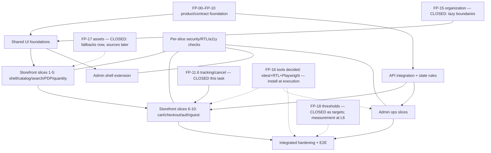

# FP-20 — Final Frontend Implementation Roadmap

> Classification: `RESOLVED — EXISTING CONTRACT` · `ADOPTED — TECHNICAL DEFAULT` ·
> `OWNER DECISION REQUIRED` (sparingly) · `UNVERIFIED / BLOCKED BY EVIDENCE`.
> Planning only — no implementation, no FP-21. Spec status ≠ implementation status throughout.

## 1. Purpose, Scope and Non-Goals

Consolidates FP-00–FP-19 into one dependency-aware execution plan of reviewable work packages with
prerequisites, acceptance evidence, and stop conditions. Non-goals: any code, tests, config, DB,
backend, commit/push/deploy, FP-21+.

## 2. Repository Baseline and Evidence Hierarchy

- Root `D:\Hyper_el-moatasem`, `master`, HEAD `83253fe9` (verified this task). Evidence order:
  implementation/tests > OpenAPI/schemas > approved decisions > prior FP specs.

## 3. FP-00–FP-19 Phase Inventory and Status

| Phase/subphase | Actual document evidence | Spec status | Impl status | Prerequisites | Outstanding decisions/gaps | Consequence |
|---|---|---|---|---|---|---|
| FP-00 governance | `FP-00-FRONTEND-GOVERNANCE.md` | CLOSED | N/A (rules) | — | None | Foundation locked |
| FP-01 gate (Design System + Prototype + harness) | No dedicated file — scope absorbed: design system → FP-10 (§3.4 gate), prototype journeys → FP-04/FP-11 screens, test harness → FP-16 strategy, serializer verify → later specs, RTL-first → FP-11.9 (FP-00 §§13–14) | MERGED INTO FP-04/FP-10/FP-11/FP-16 | N/A | — | None (absorbed, not missing) | No blocker; do not create FP-01 file |
| FP-02 | Zero references anywhere in repo (verified search) | NOT FOUND — stale numbering, no scope | N/A | — | None (nothing to recover) | False blocker removed |
| FP-03 nav decision | Locked decision consumed in FP-04/05/11.x (no file by design) | MERGED (distributed decision record) | N/A | — | None | No file needed |
| FP-04 journey | `FP-04-CUSTOMER-JOURNEY-SPECIFICATION.md` | CLOSED | N/A | — | None | Journey authority |
| FP-05 commerce rules | `FP-05-COMMERCE-UX-BUSINESS-RULES.md` | CLOSED | N/A | — | None | Money/unit rules |
| FP-06 operations | `FP-06-STORE-OPERATIONS-UX.md` | CLOSED | N/A | — | None | Ops context |
| FP-07 | Only "FP-07+ future ops/infra" mention (FP-06:30) + FP-10 §25 recorded numbering inconsistency | NOT FOUND — stale numbering; rough scope (future ops/infra/readiness) outside frontend scope | N/A | — | None (nothing frontend to recover) | False blocker removed |
| FP-08 | Zero references anywhere in repo (verified search) | NOT FOUND — stale numbering, no scope | N/A | — | None (nothing to recover) | False blocker removed |
| FP-09 IA/routes | `FP-09-INFORMATION-ARCHITECTURE.md` (98 paths) | CLOSED | N/A | — | None | Route map |
| FP-10 identity/tokens | `FP-10-VISUAL-IDENTITY-DESIGN-SYSTEM.md` | CLOSED (font: Cairo reversible default adopted this task — NOT owner approval) | N/A | — | Final sign-off still owner call | Theming + font-var buildable |
| FP-11.1–11.5 | 5 specs (D02–D39 closed per registers) | CLOSED | NOT IMPLEMENTED | — | None blocking | Storefront buildable |
| FP-11.6 tracking/cancel | `FP-11-6-ORDER-TRACKING-CANCELLATION-SPECIFICATION.md` (created this task, Outcome A recovered scope) | CLOSED | NOT IMPLEMENTED | — | None | Cancel UI unblocked |
| FP-11.7 account | `FP-11-7…` (D40–D42) | CLOSED | NOT IMPLEMENTED | — | None | Buildable |
| FP-11.7 account | `FP-11-7…` (D40–D42) | CLOSED | NOT IMPLEMENTED | — | None | Buildable |
| FP-11.8 + .2–.7 | 7 specs (D43–D48) | CLOSED | PARTIALLY (shell/login/users exist) | — | None | Extend shell, don't rebuild |
| FP-11.9/10/11 | 3 specs | CLOSED | N/A (matrices) | — | None | Cross-cutting norms |
| FP-12 components | `FP-12-UI-COMPONENTS-SPECIFICATION.md` | CLOSED | NOT IMPLEMENTED | — | C1–C3 adopted, C5 deferred (non-blocking) | Buildable |
| FP-13 contract map | `FP-13-CONTRACT-MAPPING-SPECIFICATION.md` | CLOSED | N/A (mapping) | — | None | Integration authority |
| FP-14 state/data | `FP-14-APPLICATION-STATE-DATA-MANAGEMENT-SPECIFICATION.md` | CLOSED | NOT IMPLEMENTED | — | None | State authority |
| FP-15 org | `FP-15-FILE-ORGANIZATION-SPECIFICATION.md` (created this task; lazy boundaries) | CLOSED | N/A (rules) | — | None | Placement gate resolved |
| FP-16 testing | `FP-16-FRONTEND-TESTING-QA-SPECIFICATION.md` | CLOSED (strategy) | NOT IMPLEMENTED (zero frontend tests exist) | Tooling: vitest + RTL + Playwright per FP-00-D069 (compat verified §G) | Install at execution | Strategy ready; execution gated on install |
| FP-17 assets | `FP-17-IMAGES-ASSETS-CONTENT-SPECIFICATION.md` (created this task) | CLOSED | NOT IMPLEMENTED | Domain approval before remote config | Brand/policy sources open | Constrained handling (fallbacks now) |
| FP-18 perf/sec/SEO | `FP-18-PERFORMANCE-SECURITY-SEO-SPECIFICATION.md` (created this task; web.dev thresholds verified) | CLOSED | NOT IMPLEMENTED (nothing measured) | Field traffic for compliance | Targets unmeasured (not blockers pre-UI) | Gates numeric only |
| FP-19 review gate | `FP-19-PRE-IMPLEMENTATION-READINESS-GATE.md` (created this task; per-package gate) | CLOSED | N/A (gate) | — | None | Gate usable now |

UNVERIFIED items: none material beyond the four missing docs above (stated, not hidden).

## 4. Verified Existing Implementation Inventory

| Area | Verified condition | Evidence | Next action | Risk if assumed complete |
|---|---|---|---|---|
| Storefront | Boilerplate `app/page.tsx` only | File read | Build all slices | Total rewrite assumed done |
| Admin shell | Server-gated login (`LoginForm.tsx` + `actions/auth.ts`), dashboard, users pages | Files read | Extend, never rebuild | Breaking working auth |
| Shared components | NONE (no components dir) | Glob empty | Build per FP-12 | Phantom reuse |
| API integration utils | NONE client-side (`lib/api/*` server-only) | Grep verified | `src/lib/storefront/` planned | Importing server-only to client |
| Backend API | 98 paths, frozen machines, RBAC, idempotent order create | openapi + suites | Map only (FP-13) | Invented endpoints |
| Tests | Backend suites + hermetic CI; zero frontend tests | `scripts/api/`, `ci.yml` | Tooling decisions (FP-16) | Claiming coverage |
| Tokens/RTL | FP-10 tokens verified; root layout still `lang="en"` boilerplate | Files read | RTL shell + font variable | Assuming RTL done |
| Images | External https metadata only; no pipeline/upload | `catalog/media.ts` | Constrained handling | Assuming CDN/optimization |

Reusable as-is: admin shell/auth, backend contracts, CI hermetic checks, fixtures/tooling. Verify-first:
none (all above directly inspected). Specified-not-implemented: entire storefront + admin depth.
Unsupported: payments/OTP/upload/totals/etc. (FP-11.11 §C). Remaining gates: test-tool install,
image-domain approval, field perf data (all documented in §§14/17).

## 5. Architecture and Six-Layer Roadmap

- **L1 foundation:** FP-00–FP-10 + FP-11 decisions + FP-12–14/16 constraints; FP-19 gate usable
  directly (its own document; §13 summarizes). Product/commercial/API/design decisions explicit;
  missing specs visible (§3: FP-01/02/03/07/08 classified, all others present).
- **L2 shared foundations:** FP-12 contracts + FP-15 lazy boundaries + existing app structure; minimal
  visual foundation (tokens/RTL/shell/Cairo font default reversible); NO global state/API duplication.
- **L3 API/data:** FP-13 mappings + FP-14 policies + openapi; server/client boundary enforced;
  credentials distinct; backend-authoritative money/stock; documented invalidation/retry.
- **L4 storefront slices** (§7 storefront sequence below).
- **L5 admin slices** (extend shell; every op → real route+permission).
- **L6 hardening:** final integrated verification (journeys, commerce, auth isolation, RTL/a11y,
  visual, assets, perf, SEO-public-only, errors, regression) — with per-slice checks embedded from
  the start (§11), not postponed wholesale.

## 6. Dependency Graph

Parallel-safe: L4A ∥ L5A (disjoint files) after L1/L2-minimal; L4B ∥ L5B after L3. Sequential: L3
before any mutation UI; FP-15 lazy rules govern placement from the start; FP-11.6 cancel spec feeds
cancel UI; hardening last. No circular dependencies (L6 consumes all; bootstrap order: L1 → L2-minimal → L3 → slices).

## 7. Implementation Work Packages

| ID | Scope | FP refs | Prerequisites | Reuse | Likely files (provisional) | API deps | State/data | Tests | Security | Acceptance | Evidence | Stop conditions | Status |
|---|---|---|---|---|---|---|---|---|---|---|---|---|---|
| WP-01 | RTL shell, tokens, font-var, PageContainer, Header/Footer/Nav skeleton | FP-10/09/12, L2 | L1 | Root layout (modify) | `app/layout.tsx`, `globals.css`, layout components | None (static) | UI-local | tsc/lint, RTL/manual | None (public) | Shell renders RTL, tokens applied | Token conflict → stop | Planned |
| WP-02 | Primitives: Button/Field set/Dialog/Feedback set | FP-12 | WP-01 | None | `components/ui/*` (new) | None | UI-local | Component tests (tools gated) | Confirm≠auth | Contracts per FP-12 | — | Planned |
| WP-03 | Catalog slices (home/categories/search/listings) | FP-11.1/2, FP-13 | WP-01/02 (FP-15 lazy rules govern placement) | None | `app/(store)/**` routes | catalog/search endpoints (cursor-only) | URL state, RSC reads | Integration + E2E later | Public data only | Server-driven lists, honest empty | Placement per FP-15 | Planned |
| WP-04 | PDP + variants + quantity controls | FP-11.3, FP-05 | WP-03 | WP-02 | PDP route + commerce components | products/variants/images/inventory reads | Temp selection; step rules | Component + integration | None | Variant authority, no invented prices | — | Planned |
| WP-05 | Cart (mutate/reprice/summary) | FP-11.4, FP-13/14 | WP-02/04 | None | cart route + components | cart ops (echo), XOR identity | Echo reconciliation; GET-first retry | Integration | Guest/session split | Server totals only | Ambiguity → FP-13 rules | Planned |
| WP-06 | Checkout + estimate + idempotent submit | FP-11.5, FP-13/14 | WP-05 | None | checkout route + forms | estimate/create + key, addressId/guest payloads | Same-key resolve; new-key review | Integration (+E2E) | Credential handling | 201-confirmed only | Drift/ambiguity → contract | Planned |
| WP-07 | Auth/account/guest flows | FP-11.7, FP-04 | WP-01/02 | LoginForm pattern | account routes + forms | session/register/password/orders/addresses | Lifecycle + isolation resets | Integration (+E2E) | No OTP invented; 401/403 fidelity | Session-verified states | — | Planned |
| WP-08 | Admin extension (orders/fulfillment/catalog/inventory/promos/users/audit) | FP-11.8 family | WP-02, L3 | Existing shell/pages | `app/admin/**` | Per-op routes + perms (D45) | Re-read-first; 409 flows | Integration | RBAC authoritative | Real route+perm per action | Missing route → stop, record gap | Planned |
| WP-09 | Hardening + E2E + tooling setup | FP-16/11.9/11.10 | All slices + tool decisions | Backend suites | tests/* (new, pending FP-16 tools) | Scratch-only | Isolation/cleanup | Full matrix | Leak/privilege checks | Journeys green | Tooling/env blockers → stop | Planned (tools decided; install at execution) |

Vertical slices bundle route+data+errors+responsive+tests together (§7 rule).

## 8. Storefront Delivery Sequence

WP-01 → WP-02 → WP-03 → WP-04 → WP-05 → WP-06 → WP-07 (each testable on completion; cancel UI follows
FP-11.6; image handling per FP-17 fallbacks-then-sources).

## 9. Administrative Delivery Sequence

Extend shell in place → WP-08 grouped by capability (orders/fulfillment → catalog/inventory →
promotions → users/audit), each action verified against its route+permission before UI exposure.

## 10. State/API/Commerce Integration Dependencies

Per FP-13/14 binding rules (§9 task list, all satisfied by reference): real endpoints only;
cursor-only pagination; no server-only imports in client; no global store; no unsafe auto-retry;
no cached-display purchase authorization; no client totals; no assumed merges/listings/OTP/reset/
payments/concurrency APIs; no premature success states. Unresolved mappings: none (FP-13 complete);
FP-11.6 cancel/account-order flows specified (cancel UI follows its spec).

## 11. Embedded Testing and QA Requirements

Per FP-16 + decided stack (vitest + RTL + Playwright per FP-00-D069; install at first test-writing
package — not installed now): tsc/lint per package; component tests; integration per FP-13 matrix;
critical-journey E2E (tools+env gated); permission/identity checks per slice; RTL/a11y per slice;
perf measured where relevant (web.dev targets LCP≤2.5s/INP≤200ms/CLS≤0.1 p75 — goals, never results).
Evidence rules: command + result + env + mock/integration/E2E label + skips/limits. Mocks ≠ backend proof; build ≠ journey proof; frontend pass ≠ backend auth proof.

## 12. Security and Project-Safety Gates

Dev/test only; no prod deploy/DB/migrations/seeds; no paid upgrades; no backend changes without
separate authorization; no `AGENT-HANDOFF.md` without separate authorization; no intermediate
commit/push without explicit authorization; preserve tree; no destructive git; no new deps without
need+compat+scope approval; no fake-as-real data; no prod secrets. DB-writing tests: prove scratch
via read-only identity check first (`REFUSED_DB` pattern); abort otherwise. Sessions (customer 30d /
admin 8h / guest-bearer / order-credential-90d) strictly separated; no browser password storage; no
credential URLs; hiding ≠ authorization.

## 13. Layer-Level Definitions of Done

| Layer | Prereqs | Deliverables | Integration | Tests/evidence | Security/data | RTL/a11y | Blockers | Limitations OK | Review evidence |
|---|---|---|---|---|---|---|---|---|---|
| L1–L3 | Specs cited | Cited specs used as constraints | N/A (planning) | This doc | Gates stated | Norms cited | §14 gaps | Missing docs listed | This roadmap |
| Slices | FP-15 lazy rules, FP-11.6 cancel spec | Working UI per WP | Real routes per FP-13 | Per-WP matrix | Per-WP rules | Per-slice checks | Tooling/env (install at execution) | Deferred features noted | Demos + results |
| Hardening | All slices + tools | Green matrix | E2E + regression | Full evidence | Leak/privilege proof | Sweep + manual | Env/policies | Known limits | Report |

Minimum rules (§12 task lists) apply verbatim at execution; no layer done by files-written alone.

## 14. Readiness Gate and Resolution of Missing Specifications

- **FP-15 (now present):** lazy boundaries govern placement from the start (§6 graph updated);
  single-file primitives need no gate.
- **FP-17 (now present):** fallbacks-first image handling; remote-domain approval still required
  before remote config.
- **FP-18 (now present):** web.dev targets recorded as goals; measurement at hardening.
- **FP-19 (now present as document):** per-package gate usable directly; this §14 retained as the
  roadmap-level summary (no conflict — §19 verification below rechecked).
- **FP-11.6 (now present):** cancel/account-order flows specified; cancel UI unblocked.
- **Font:** Cairo reversible default adopted (see §16); final owner sign-off still open, blocks visual
  sign-off only.
- **Test tools:** vitest + RTL + Playwright decided per FP-00-D069 (compat verified §16); install at
  first test-writing package.

## 15. Cross-Cutting Versus Final-Hardening Activities

Upfront (blocking bad architecture): credential separation, server/client boundary, no-global-store,
server-authoritative money, D45 visibility. Per-package: component/integration/RTL/failure/security
checks. Final (L6): full journeys, consolidated security, sweep, measured perf, assets, public SEO,
regression. Security never end-only; perf never before UI; SEO never before internal screens.

## 16. Decision and Dependency Register

| ID | Question | Evidence | Status | Decision/default | Rationale | Layer/WP | Blocking | Approval? |
|---|---|---|---|---|---|---|---|---|
| FP20-R1 | Missing FP-15/17/18/19 handling | Glob empty (verified) | RESOLVED — EXISTING CONTRACT (absence verified) | Record as gates, don't fabricate | Honesty over completeness | All | Placement/assets/thresholds | No (evidence) |
| FP20-R2 | FP-11.6 cancel detail | Referenced, file absent | UNVERIFIED / BLOCKED BY EVIDENCE | Gate cancel UI on its spec | No invented flow | WP-06/08 | Cancel UI only | No (evidence) |
| FP20-R3 | Font default (owner sign-off still open) | FP-10 §7 comparison (CSS-API verified) + §26 open decisions | ADOPTED — REVERSIBLE TYPOGRAPHY DEFAULT | Cairo variable (arabic+latin), display=swap, fallback stack, FP-10 weights; logo-coherent, single file, OFL; Plex noted alternative | WP-01/final | Visual sign-off only | No (default, not approval) |
| FP20-R4 | Test tooling selection | FP-00-D069 (locked: vitest + RTL + Playwright) + compat verified (RTL v16 peers ^18\|\|^19; Vitest needs jsdom/happy-dom at install; Playwright independent) | RESOLVED — EXISTING CONTRACT (stack decided; install deferred to execution) | Honors locked governance; no new evaluation needed | WP-09/all | Install action | No (evidence) |
| FP20-R5 | Parallelism model | Disjoint file sets verified | ADOPTED — TECHNICAL DEFAULT | L4A∥L5A, L4B∥L5B; rest sequential | Safe per evidence | All | None | No |
| FP20-R6 | Vertical slices over layers | Task + FP-16 strategy | ADOPTED — TECHNICAL DEFAULT | Testable increments | Reviewability | WP-03–08 | None | No |
| FP20-R7 | No new deps/libs assumed | package.json verified | RESOLVED — EXISTING CONTRACT | Use fetch/RSC/primitives | Zero need proven | L2/L3 | None | No |
| FP20-R8 | FP-01/02/03/07/08 disposition | Repo-wide search (FP-01 gate refs in FP-00; FP-03 nav consumed; FP-02/08 zero refs; FP-07 future-ops mention + FP-10 inconsistency note) | RESOLVED — EXISTING CONTRACT | FP-01 MERGED; FP-03 MERGED; FP-02/08 stale-numbering removed; FP-07 stale-numbering removed | No scope lost; false blockers removed | Roadmap | None | No |
| FP20-R9 | FP-11.6 recovery | FP-04 journey + cancel route + FP-11.7 pointers (Outcome A evidenced) | RESOLVED — EXISTING CONTRACT | New spec created, scope-bounded | Cancel UI unblocked | WP-06/08 | None | No |
| FP20-R10 | FP-15/17/18/19 creation | Absence verified by glob; contents per task §§6–9 | RESOLVED — EXISTING CONTRACT (new docs this task) | Lazy boundaries; fallbacks-first; web.dev targets; per-package gate | Planning complete | All | Install/field-data at execution | No |

## 17. Remaining Blockers and Known Limitations

Blockers (implementation): test-tool install action, image-domain approval, field perf data.
Limitations (documented, non-blocking): font final sign-off, D39-staff-path UX (existing),
payments/OTP/upload (unsupported). No missing-spec blockers remain (FP-11.6/15/17/18/19 created;
FP-01/02/03/07/08 classified).

## 18. Final Acceptance Criteria for FP-20

- Inventory truthful (§3) · baseline verified (§4) · 6 layers coherent (§5) · graph acyclic (§6) ·
  9 WPs complete per §7 fields (§7) · sequences + integration deps (§§8–10) · embedded testing (§11) ·
  safety gates (§12) · DoD per layer (§13) · missing specs gated (§14) · cross/final split (§15) ·
  register consistent (§16) · blockers explicit (§17) · this verification (§19).

## 19. Verification and Closure Report

- Re-read this document in full (done — §§1–19 coherent; no invented endpoints/rules/statuses found
  on review; FP-19 now a real document gate (§§6/13/14 updated; §19 verification re-run this task).
- Phase inventory re-checked against glob output (§3 matches files present; missing specs confirmed resolved-or-classified (§3 rows for FP-01/02/03/07/08 + new FP-11.6/15/17/18/19 files).
- Spec/implementation never conflated (dual statuses everywhere; boilerplate/admin-partial explicitly stated).
- Existing code claims checked (7 tsx files, no components dir, no client utils, CI hermetic+local).
- No circular dependencies (graph flows L1→L6; bootstrap noted).
- Final `git status` vs initial: only the new FP-20 file added (verified below).
- Untracked target: no Git diff available — content-level review performed instead (stated honestly).
- Nothing run, built, formatted, or migrated.

---

*End of FP-20 — planning only; implementation not started.*
